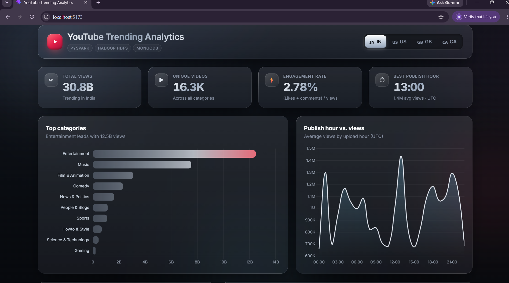
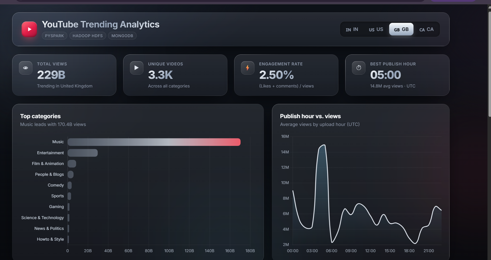

# YouTube Big Data Analytics

A distributed analytics pipeline for YouTube trending videos (India, US, UK, Canada), built on a multi-machine **Hadoop HDFS + Apache Spark** cluster, with results stored in **MongoDB** and visualised in a **React** dashboard.

```
CSV files ──► HDFS (NameNode + DataNodes) ──► Spark cluster (PySpark job)
                                                   │
                                                   ▼
            React dashboard ◄── Express API ◄── MongoDB
```

## Screenshots

The dashboard has a dark glass-and-metal design. Switch between India, the US, the UK and Canada with the buttons at the top right.

**Overview: India.** Summary stats, top categories by views, and average views by publish hour.



**Channel leaderboard and most engaging videos: India.**


<table>
  <tr>
    <td width="50%"></td>
    <td width="50%"></td>
  </tr>
  <tr>
    <td align="center"><b>United Kingdom</b>: Music leads with 170.4B views</td>
    <td align="center"><b>Canada</b>: Entertainment and Music close at the top</td>
  </tr>
</table>

**Channel leaderboard and most engaging videos: United Kingdom.**


## Components

| Folder | What it is |
|---|---|
| `docker-compose.yml` | **Master node**: HDFS NameNode, Spark Master, MongoDB |
| `worker-youtube/` | **Worker node**: HDFS DataNode + Spark Worker (run on each worker machine) |
| `scripts/a.py` | PySpark job: cleans the data and writes 4 aggregated collections to MongoDB |
| `scripts/run_spark.ps1` | Submits the PySpark job to the cluster |
| `backend/` | Express + Mongoose REST API (`/api/categories`, `/api/trends`, `/api/top-videos`, `/api/channels`) |
| `frontend/frontend/` | React + Vite + Chart.js dashboard |
| `data/` | Put the dataset CSVs here (not committed) |

## Dataset

Download the [Trending YouTube Video Statistics](https://www.kaggle.com/datasets/datasnaek/youtube-new) dataset from Kaggle and copy these files into `data/`:

```
CAvideos.csv  GBvideos.csv  INvideos.csv  USvideos.csv
```

## Setup

> **Setting this up in the lab?** Follow **[docs/LAB_SETUP.md](docs/LAB_SETUP.md)**. It has the full master/worker checklist, firewall steps, and a troubleshooting table for every error we've hit.

The configuration assumes a LAN with the master at `10.77.120.200`. Change the IPs in `docker-compose.yml`, `scripts/a.py`, `scripts/run_spark.ps1` and each worker's `.env` to match your network.

### 1. Master node

```bash
docker compose up -d
```

Open inbound TCP ports `9000, 9870, 7077, 7078, 7079, 8080, 27017` in the firewall for your LAN.

### 2. Each worker node

```bash
cd worker-youtube
cp .env.example .env      # set MASTER_IP, this machine's WORKER_IP, and DATANODE_PORT
docker compose up -d
```

> Give each worker a **different** `DATANODE_PORT` (e.g. `9866`, `9876`). Otherwise the NameNode
> treats them as the same node. Don't use `9867`; it is the DataNode's default IPC port.

Check: Spark UI at `http://<master>:8080` and HDFS UI at `http://<master>:9870` should list all workers.

### 3. Load data into HDFS

```powershell
docker exec namenode hdfs dfs -mkdir -p /youtube/raw
docker exec namenode sh -c "hdfs dfs -put -f /data/*.csv /youtube/raw/"
```

(In Git Bash, run `export MSYS_NO_PATHCONV=1` first.)

### 4. Run the Spark job

```powershell
.\scripts\run_spark.ps1
```

It writes `category_stats`, `hourly_trends`, `top_videos` and `channel_leaderboard` to the `youtube_stats` database.

### 5. Backend and dashboard

```bash
cd backend && npm install && node server.js          # http://localhost:5000
cd frontend/frontend && npm install && npm run dev   # http://localhost:5173
```

## Tech stack

Hadoop 3.2.1 · Spark 3.5.9 (PySpark) · MongoDB 7 · Docker Compose · Node.js / Express 5 · React 19 · Vite · Chart.js
