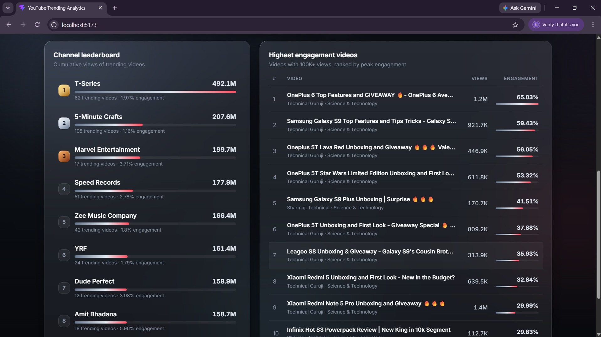
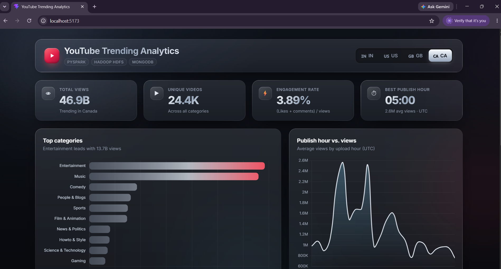
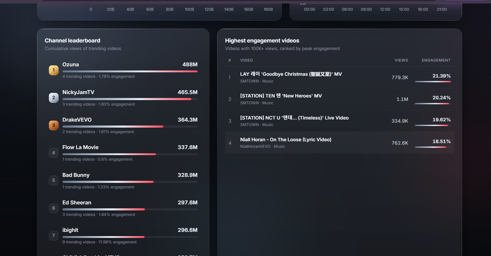

# Distributed Big Data Analytics of YouTube Trending Videos Using Hadoop HDFS, Apache Spark and MongoDB

**Project Report**

| | |
|---|---|
| **Course** | Big Data |
| **Submitted by** | Vikash Adivasi (23121021)<br>Noman Uddin (231210079)<br>Vineet (231210123)<br>Tanish Jagetiya (231210112) |
| **Supervisor** | Himadri Singh |
| **Department** | Computer Science and Engineering |
| **Date** | 15-11-2026 |

---

## Table of Contents

1. [Abstract](#1-abstract)
2. [Introduction](#2-introduction)
3. [Objectives](#3-objectives)
4. [Dataset Description](#4-dataset-description)
5. [System Architecture](#5-system-architecture)
6. [Tools and Technologies](#6-tools-and-technologies)
7. [Methodology](#7-methodology)
8. [Implementation and Setup](#8-implementation-and-setup)
9. [Results and Discussion](#9-results-and-discussion)
10. [Challenges Faced](#10-challenges-faced)
11. [Limitations and Future Work](#11-limitations-and-future-work)
12. [Conclusion](#12-conclusion)
13. [References](#13-references)
14. [Appendix: Project Structure](#appendix-project-structure)

---

## 1. Abstract

This project builds a distributed analytics pipeline for YouTube trending-video data from four countries: India, the United States, the United Kingdom and Canada. The raw CSV files are stored in a multi-machine **Hadoop Distributed File System (HDFS)** cluster and processed in parallel by an **Apache Spark** cluster running a PySpark job. The job cleans the data, enriches it with category names and an engagement metric, and computes four aggregated datasets: category statistics, publish-hour trends, the most engaging videos, and a channel leaderboard. The results are written to **MongoDB**, served through an **Express.js REST API**, and visualised in an interactive **React** dashboard. The whole cluster runs in Docker containers across separate lab machines connected over a LAN, with one master node and two or more worker nodes.

## 2. Introduction

YouTube publishes daily lists of trending videos for each country. These lists show which content gets attention in different regions, which categories dominate, and how viewer engagement varies. The full dataset holds hundreds of thousands of records with long free-text fields such as titles, tags and descriptions, which makes it a practical case for big data tools.

A single machine can process data of this size, but the aim of the project is to show how a real distributed system works: data split into blocks and replicated across nodes, computation sent to the workers, and results collected into a database that an application can query. Hadoop and Spark were chosen because they are the standard open-source stack for this kind of batch analytics.

## 3. Objectives

1. Deploy a multi-node Hadoop HDFS cluster (one NameNode, two or more DataNodes) on separate physical machines.
2. Deploy an Apache Spark standalone cluster (one Master, two or more Workers) on the same machines.
3. Store the raw trending-video CSVs in HDFS with a replication factor of 2.
4. Write a PySpark job that cleans, transforms and aggregates the data in parallel.
5. Persist the aggregated results in MongoDB.
6. Expose the results through a REST API and present them in a web dashboard with per-country filtering.

## 4. Dataset Description

**Source:** [Trending YouTube Video Statistics](https://www.kaggle.com/datasets/datasnaek/youtube-new) (Kaggle, by Mitchell J.)

**Files used:**

| File | Country |
|---|---|
| `INvideos.csv` | India |
| `USvideos.csv` | United States |
| `GBvideos.csv` | United Kingdom |
| `CAvideos.csv` | Canada |

**Key attributes:**

| Column | Description |
|---|---|
| `video_id` | Unique video identifier |
| `trending_date` | Date the video appeared on the trending list |
| `title`, `channel_title` | Video title and channel name |
| `category_id` | Numeric YouTube category ID |
| `publish_time` | Upload timestamp (UTC) |
| `views`, `likes`, `dislikes`, `comment_count` | Engagement counters on that trending date |
| `tags`, `description` | Free-text fields (often multi-line) |

A video can appear on the trending list on several days, so the same `video_id` occurs many times with growing counts. The pipeline handles this explicitly (see Section 7).

## 5. System Architecture

```
CSV files ──► HDFS (NameNode + DataNodes) ──► Spark cluster (PySpark job)
                                                   │
                                                   ▼
            React dashboard ◄── Express API ◄── MongoDB
```

### 5.1 Node layout

| Node | Services | Ports |
|---|---|---|
| **Master** | HDFS NameNode, Spark Master, MongoDB, (Spark driver at job time) | 9000, 9870, 7077, 7078, 7079, 8080, 27017 |
| **Worker** (×2 or more) | HDFS DataNode, Spark Worker (2 cores, 2 GB) | 9864, unique `DATANODE_PORT`, 7079, 8081 |

All services run in Docker containers. The master uses [docker-compose.yml](docker-compose.yml) and each worker uses [worker-youtube/docker-compose.yml](worker-youtube/docker-compose.yml), configured through a per-machine `.env` file.

### 5.2 Data flow

1. The CSV files are uploaded to HDFS under `/youtube/raw/`. HDFS splits them into blocks and stores two replicas of each block on the DataNodes.
2. `spark-submit` starts the PySpark driver on the master. The Spark Master assigns executors on the workers.
3. Executors read HDFS blocks, run the transformations, and write the four result collections to MongoDB through the MongoDB Spark Connector.
4. The Express API reads the collections and returns JSON filtered by country.
5. The React dashboard calls the API and draws the charts and tables.

## 6. Tools and Technologies

| Layer | Technology | Purpose |
|---|---|---|
| Distributed storage | Hadoop HDFS 3.2.1 | Block storage with replication across worker machines |
| Distributed processing | Apache Spark 3.5.9 (PySpark) | Parallel cleaning and aggregation |
| Connector | MongoDB Spark Connector 10.4.0 | Writes Spark DataFrames to MongoDB |
| Database | MongoDB 7 | Stores aggregated results |
| Containerisation | Docker, Docker Compose | Identical, repeatable deployment on every machine |
| Backend | Node.js, Express 5, Mongoose | REST API |
| Frontend | React 19, Vite, Chart.js | Interactive dashboard |

## 7. Methodology

The processing logic is in [scripts/a.py](scripts/a.py).

### 7.1 Ingestion

The CSVs are read from `hdfs://<master>:9000/youtube/raw/*.csv` with `multiLine` and quote-escape options turned on, because descriptions contain line breaks and quoted text. The country code is extracted from each row's source file name (`INvideos.csv` → `IN`) using `input_file_name()` and a regular expression.

### 7.2 Cleaning

- Remove rows with a null `video_id` or the corrupt value `#NAME?`.
- Cast `views`, `likes`, `dislikes` and `comment_count` to `Long`, and `category_id` to `Integer`; fill missing values with 0.
- Drop rows with zero views.
- Remove duplicates on (`video_id`, `trending_date`, `country`).

### 7.3 Enrichment

- **Category name:** map the numeric `category_id` to a readable name (Music, Entertainment, Gaming and so on) with a Spark map expression. Unknown IDs become "Other".
- **Engagement rate:**

  ```
  engagement_rate = (likes + comment_count) / views × 100
  ```

The enriched DataFrame is **cached** across the executors because four separate aggregations are run on it. This avoids reading and cleaning the data from HDFS four times.

### 7.4 Aggregations

| Output collection | Grouping | Metrics |
|---|---|---|
| `category_stats` | country, category | trending entries, unique videos, total/average views, total/average likes, total comments, average engagement |
| `hourly_trends` | country, publish hour (UTC) | video count, average views, average engagement |
| `top_videos` | country, video | peak views, likes, comments and peak engagement rate; top 100 by engagement among videos with at least 100,000 views |
| `channel_leaderboard` | country, channel | number of trending videos, cumulative peak views and likes, average engagement; top 50 by views |

For `top_videos` and `channel_leaderboard`, each video is first reduced to its **peak** values (maximum views, likes and comments across all its trending days). Without this step, a video that trended for ten days would be counted ten times and channels with long-trending videos would be inflated. The 100,000-view threshold removes small videos whose engagement rate is high only because the view count is tiny.

### 7.5 Storage and serving

Each result is written to the `youtube_stats` database in MongoDB in overwrite mode, so the job can be re-run safely. The Express server ([backend/server.js](backend/server.js)) exposes:

| Endpoint | Returns |
|---|---|
| `GET /api/categories?country=IN` | Category statistics sorted by total views |
| `GET /api/trends?country=IN` | Average views per publish hour |
| `GET /api/top-videos?country=IN` | Top 20 most engaging videos |
| `GET /api/channels?country=IN` | Top 15 channels by cumulative views |

## 8. Implementation and Setup

> **For the full lab procedure**, see **[docs/LAB_SETUP.md](docs/LAB_SETUP.md)**. It has the complete master/worker checklist, firewall steps, and a troubleshooting table for every error we hit.

### 8.1 Prerequisites

- Docker Desktop on every machine
- Node.js on the master (for the API and dashboard)
- All machines on the same LAN
- The dataset CSVs (`CAvideos.csv`, `GBvideos.csv`, `INvideos.csv`, `USvideos.csv`) copied into `data/`

The configuration assumes the master is at `10.77.120.200`. Change the IPs in `docker-compose.yml`, `scripts/a.py`, `scripts/run_spark.ps1` and each worker's `.env` to match your network.

### 8.2 Step 1: Start the master node

```bash
docker compose up -d
```

Open inbound TCP ports `9000, 9870, 7077, 7078, 7079, 8080, 27017` in the firewall for your LAN.

### 8.3 Step 2: Start each worker node

```bash
cd worker-youtube
cp .env.example .env      # set MASTER_IP, this machine's WORKER_IP, and DATANODE_PORT
docker compose up -d
```

> Give each worker a **different** `DATANODE_PORT` (e.g. `9866`, `9876`). Otherwise the NameNode treats them as the same node. Don't use `9867`; it is the DataNode's default IPC port.

**Verification:** the Spark UI at `http://<master>:8080` and the HDFS UI at `http://<master>:9870` should list all workers.

### 8.4 Step 3: Load the data into HDFS

```powershell
docker exec namenode hdfs dfs -mkdir -p /youtube/raw
docker exec namenode sh -c "hdfs dfs -put -f /data/*.csv /youtube/raw/"
```

(In Git Bash, run `export MSYS_NO_PATHCONV=1` first.)

### 8.5 Step 4: Run the Spark job

```powershell
.\scripts\run_spark.ps1
```

The job writes `category_stats`, `hourly_trends`, `top_videos` and `channel_leaderboard` to the `youtube_stats` database and prints `Pipeline completed successfully!` at the end.

### 8.6 Step 5: Start the backend and dashboard

```bash
cd backend && npm install && node server.js          # http://localhost:5000
cd frontend/frontend && npm install && npm run dev   # http://localhost:5173
```

## 9. Results and Discussion

The dashboard has a dark glass-and-metal design. The buttons at the top right switch between India, the US, the UK and Canada.

### 9.1 Overview: India


*Figure 1: Summary statistics, top categories by views, and average views by publish hour for India.*

For India, the trending data covers **30.8 billion views** across **16.3 thousand unique videos**, with an average engagement rate of **2.78%**. **Entertainment** is clearly the leading category with about 12.5 billion views, followed by Music and Film & Animation. Videos published around **13:00 UTC** have the highest average views (about 1.4 million). The publish-hour curve has several sharp peaks rather than one smooth maximum, which suggests that upload timing matters but interacts with other factors such as channel size.

### 9.2 Channel leaderboard and most engaging videos: India



*Figure 2: Top channels by cumulative peak views and the videos with the highest engagement rate in India.*

### 9.3 Country comparison: United Kingdom and Canada

<table>
  <tr>
    <td width="50%"></td>
    <td width="50%"></td>
  </tr>
  <tr>
    <td align="center"><b>United Kingdom</b>: Music leads with 170.4B views</td>
    <td align="center"><b>Canada</b>: Entertainment and Music close at the top</td>
  </tr>
</table>

*Figure 3: Overview dashboards for the United Kingdom and Canada.*

The category mix differs strongly between countries. In the **United Kingdom**, **Music** dominates with 170.4 billion views. In **Canada**, Entertainment and Music are close at the top. In India, Entertainment leads by a wide margin. These differences show why the pipeline groups every metric by country instead of producing only global totals.

### 9.4 Channel leaderboard and most engaging videos: United Kingdom



*Figure 4: Top channels and most engaging videos in the United Kingdom.*

### 9.5 Summary of findings

1. The dominant trending category depends on the country: Entertainment in India, Music in the UK, and a close split in Canada.
2. Publish hour affects average views, with clear peaks at particular UTC hours.
3. Using peak values per video gives a fair channel ranking and prevents long-trending videos from being counted many times.
4. The most engaging videos are not always the most viewed; engagement and reach are different measures of success.

## 10. Challenges Faced

Most of the difficulty was in networking the Docker containers across physical machines, not in the analytics code. The main problems and their solutions were:

| Problem | Cause | Solution |
|---|---|---|
| Workers could ping the master but not connect | Windows firewall blocked the service ports | Opened the required inbound TCP ports on every machine |
| Spark worker failed with `BindException` | The LAN IP does not exist inside the container | Bind to `0.0.0.0` and advertise the LAN IP with `SPARK_PUBLIC_DNS` |
| Only one DataNode appeared even with two workers | Both workers used the same DataNode port, so the NameNode treated them as one node | A unique `DATANODE_PORT` per worker |
| DataNode exited with "Address already in use" | Port 9867 collides with the DataNode's IPC port | Use other ports such as 9866 and 9876 |
| HDFS commands failed in Git Bash with `No FileSystem for scheme "C"` | Git Bash rewrote HDFS paths into Windows paths | `export MSYS_NO_PATHCONV=1`, or use PowerShell |
| Spark job stuck at "Initial job has not accepted any resources" | Executors could not reach the driver | Fixed driver and block-manager ports (7078, 7079) and opened them in the firewall |
| CSV rows split incorrectly | Multi-line, quoted descriptions | `multiLine` and `escape` options on the CSV reader |

The full table is in [docs/LAB_SETUP.md](docs/LAB_SETUP.md#8-troubleshooting).

## 11. Limitations and Future Work

**Limitations**

- IP addresses are fixed in the configuration and must be edited when the lab network changes.
- The pipeline is a batch job; results change only when the job is run again.
- The dataset is historical (2017–2018) and does not include recent trends.
- The publish-hour analysis uses UTC, not each country's local time.

**Future work**

- Add streaming ingestion (for example Kafka with Spark Structured Streaming) from the YouTube Data API.
- Convert publish hours to local time for each country.
- Add text analysis of titles and tags (keyword frequency, sentiment).
- Use service discovery or hostnames instead of fixed IPs.
- Add the remaining countries in the dataset (DE, FR, JP, KR, MX, RU).

## 12. Conclusion

The project shows a complete big data pipeline running on real separate machines: distributed, replicated storage in HDFS; parallel processing in Spark; result storage in MongoDB; and a web dashboard for presenting the findings. The analysis found clear differences between countries in which categories trend, a measurable effect of publish time on views, and the importance of de-duplicating repeated trending entries before ranking channels. The project also gave practical experience with the networking and configuration work that distributed systems need, which is documented in the lab setup guide so the cluster can be rebuilt reliably.

## 13. References

1. Mitchell J. *Trending YouTube Video Statistics.* Kaggle. https://www.kaggle.com/datasets/datasnaek/youtube-new
2. Apache Software Foundation. *Apache Hadoop 3.2.1 Documentation.* https://hadoop.apache.org/docs/r3.2.1/
3. Apache Software Foundation. *Spark 3.5 Documentation.* https://spark.apache.org/docs/3.5.0/
4. MongoDB, Inc. *MongoDB Spark Connector.* https://www.mongodb.com/docs/spark-connector/current/
5. Docker, Inc. *Docker Compose Documentation.* https://docs.docker.com/compose/

---

## Appendix: Project Structure

| Folder / file | Description |
|---|---|
| `docker-compose.yml` | **Master node**: HDFS NameNode, Spark Master, MongoDB |
| `worker-youtube/` | **Worker node**: HDFS DataNode + Spark Worker (run on each worker machine) |
| `scripts/a.py` | PySpark job: cleans the data and writes 4 aggregated collections to MongoDB |
| `scripts/run_spark.ps1` | Submits the PySpark job to the cluster |
| `backend/` | Express + Mongoose REST API |
| `frontend/frontend/` | React + Vite + Chart.js dashboard |
| `docs/LAB_SETUP.md` | Detailed lab setup guide and troubleshooting |
| `docs/screenshots/` | Dashboard screenshots used in this report |
| `data/` | Dataset CSVs (not committed) |
